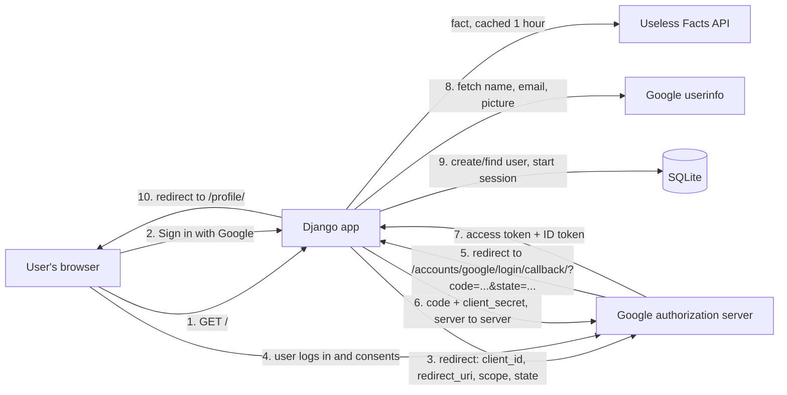
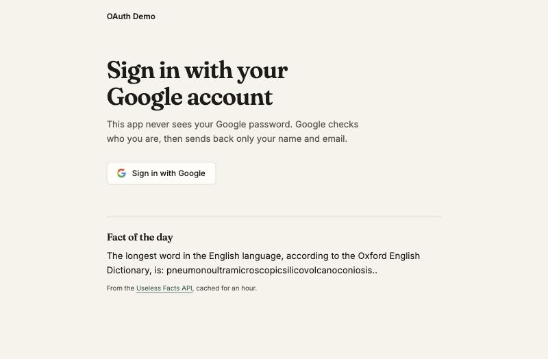
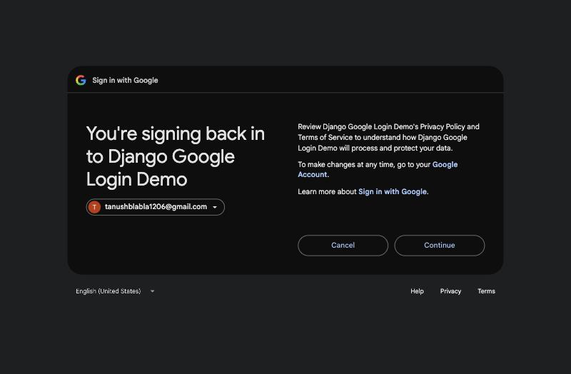
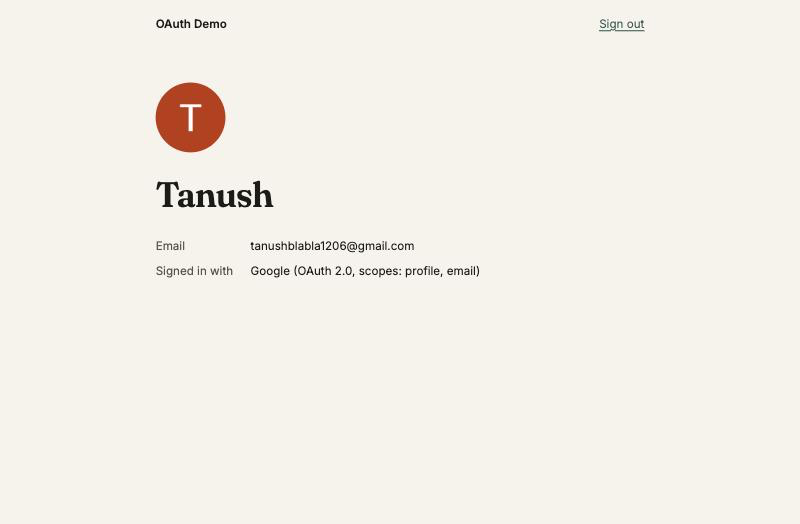

# Google OAuth 2.0 Login in Django

A small Django app where users sign in with their Google account using
[django-allauth](https://docs.allauth.org/en/latest/). After login, a profile page
shows the name and email Google returned. The welcome page shows a "fact of the day"
from the [Useless Facts API](https://uselessfacts.jsph.pl/).

## Members and roles

| Member | Role |
|---|---|
| Tanush Pillai | Development, research, documentation |
| Pratik Bherwani | Development, research, documentation |
| Ridhima Soni | Development, research, documentation |
| Iknoor Kaur | Development, research, documentation |

We worked together on one laptop (pair/mob programming), so all four of us share every
role and can each explain any part of the project.

## Architecture



### Project structure

```
config/settings.py   allauth setup, Google scopes, secrets read from .env
config/urls.py       /accounts/ (allauth) and the core app
core/views.py        home (with cached fact) and profile (login required)
core/templates/      home.html and profile.html
templates/base.html  shared layout and sign-out button
static/style.css     styling
```

## Setup

1. **Clone the repo and install the dependencies**

   ```bash
   python3 -m venv .venv
   source .venv/bin/activate
   pip install -r requirements.txt
   ```

2. **Create Google OAuth credentials** (free)
   - Go to [Google Cloud Console](https://console.cloud.google.com/) and create a project.
   - Open **APIs & Services → OAuth consent screen**. Choose *External*, fill in the app
     name and your email, and add yourselves as test users.
   - Open **APIs & Services → Credentials → Create credentials → OAuth client ID**.
     Choose *Web application*.
   - Under **Authorized redirect URIs**, add exactly:
     `http://localhost:8000/accounts/google/login/callback/`
   - Copy the client ID and client secret.

3. **Add your secrets to a `.env` file.** `.env` is in `.gitignore`, so it is never committed.

   ```bash
   cp .env.example .env
   ```

   Then put your `GOOGLE_CLIENT_ID`, `GOOGLE_CLIENT_SECRET` and a random `DJANGO_SECRET_KEY` in `.env`.

4. **Create the database and run the server**

   ```bash
   python manage.py migrate
   python manage.py runserver
   ```

   Open http://localhost:8000. Use `localhost`, not `127.0.0.1`, because the redirect
   URI must match exactly.

## Screenshots

| Welcome page | Google consent | Profile page |
|---|---|---|
|  |  |  |

## API usage and caching

- The Useless Facts API needs no key. We call the `facts/today` endpoint, which only
  changes once a day.
- The result is stored in Django's cache for one hour, so the API gets at most one call
  per hour however many times the page loads.
- If the API is down or slow (5 second timeout), the page still loads and shows a short
  message instead of the fact.

## Research questions

### 1. The authorization code flow, step by step

1. The user clicks **Sign in with Google** on our site.
2. Django (through allauth) redirects the browser to Google's authorization page. The URL
   carries our **client ID**, our **redirect URI**, the **scopes** we want (`profile email`),
   `response_type=code`, and a random **state** value.
3. The user logs in to Google, if they aren't already, and sees a consent screen listing
   what our app is asking for.
4. When the user agrees, Google redirects the browser back to our redirect URI with a
   short-lived **authorization code** and the same `state` value.
5. Our server checks that `state` matches what it sent. This proves the response belongs
   to a login we started and protects against CSRF.
6. Our server sends the code, the client ID and the **client secret** directly to Google's
   token endpoint. This happens server to server, so the browser never sees the secret or
   the tokens.
7. Google checks everything and returns an **access token**, plus an **ID token** with
   the user's identity.
8. Our server uses the token to get the user's name, email and picture.
9. allauth finds or creates a Django user for that Google account, logs them in with a
   normal Django session, and redirects to `/profile/`.

The code on its own is useless to an attacker. It can only be exchanged once, it expires
quickly, and exchanging it needs the client secret, which only our server has.

### 2. Client ID, client secret, redirect URI and scopes

- **Client ID**: the public identifier of our app at Google. It appears in the browser
  URL and is not secret.
- **Client secret**: a password for our app that only our server and Google know. We use
  it to exchange the code for tokens. It goes in `.env` and must never be committed.
- **Redirect URI**: the address Google sends the user back to after login. Google only
  redirects to URIs we registered in advance, so an attacker can't make it send the code
  to their own site.
- **Scopes**: the specific permissions we ask for. We only ask for `profile` (name and
  picture) and `email`. The consent screen lists them, and we can't access anything
  outside them, such as Gmail or Drive.

### 3. Authentication vs authorization

- **Authentication** answers "who are you?" It proves identity. In our app, Google
  confirms that the user really owns that Google account.
- **Authorization** answers "what are you allowed to do or access?" It grants
  permissions. In OAuth, the user allows our app to read their profile and email, and
  nothing more.

OAuth 2.0 itself is an **authorization** protocol: it hands out access tokens. Logging in
with Google also uses **OpenID Connect**, a layer on top of OAuth 2.0 that adds the ID
token, which is how we get the **authentication** part. In our app, authorization also
appears in a simple form: `/profile/` has `@login_required`, so only signed-in users can
open it.
